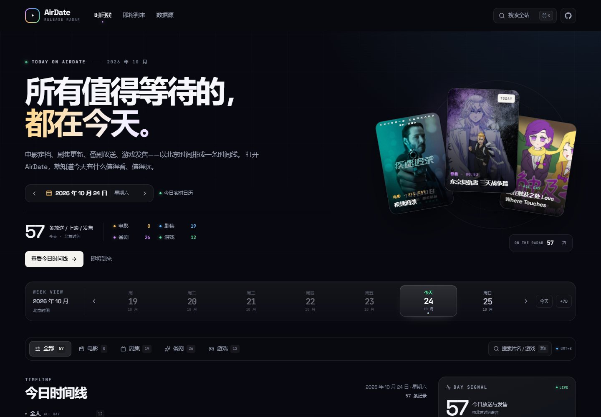
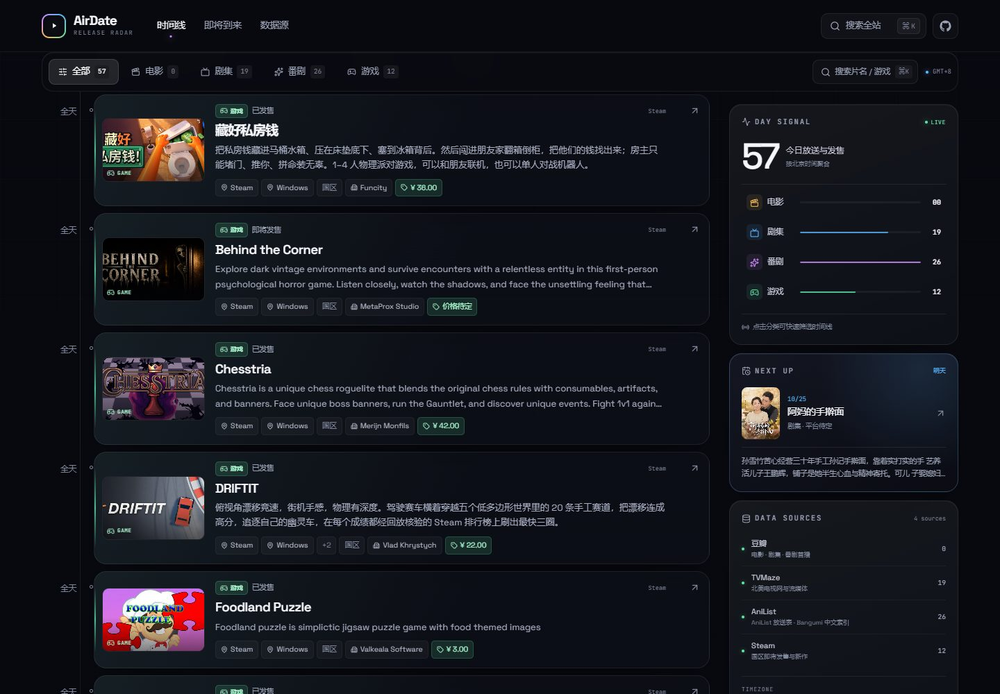
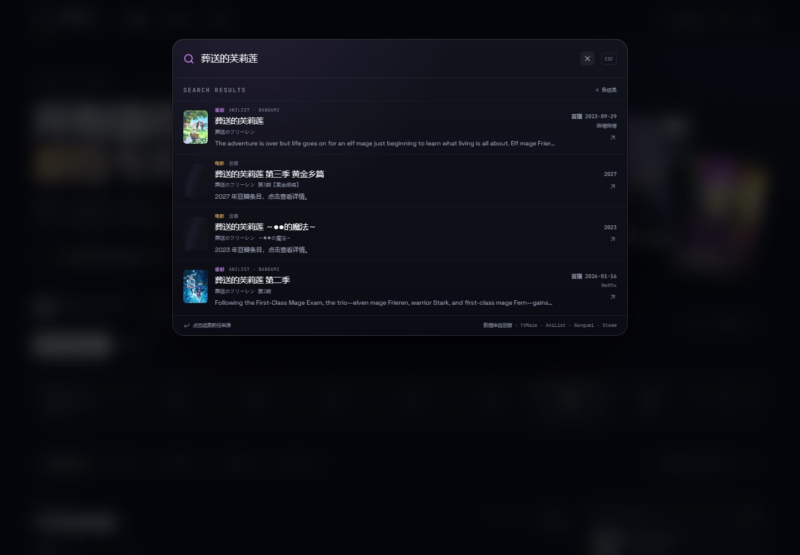
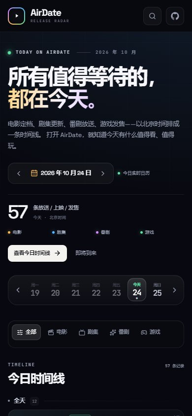

<div align="center">

<a href="https://github.com/AchooLuv/AirDate">
  
</a>

# AirDate

**电影、剧集、番剧与游戏的上映 / 放送 / 发售日历。**

默认展示今天，以北京时间把每一条值得期待的放送、上映和发售排成时间线。

[](https://github.com/AchooLuv/AirDate/actions/workflows/ci.yml)
[](https://nextjs.org/)
[](https://react.dev/)
[](https://www.typescriptlang.org/)
[](https://vercel.com/)
[](#架构)
[](./LICENSE)
[](./data/README.md)

[功能](#功能) · [演示](#界面) · [架构](#架构) · [数据源](#数据源) · [本地运行](#本地运行) · [部署](#部署到-vercel) · [API](#api) · [SEO](#seo)

</div>

---

## 这是什么？

**AirDate** 是一个面向中文用户的娱乐档期聚合站：

- **电影**：什么时候上映、在哪个院线/地区、导演是谁
- **剧集**：今天更新第几集、在哪个电视网或流媒体播出
- **番剧**：这一话什么时候放送、在哪个平台配信
- **游戏**：什么时候发售、卖多少钱、登陆哪些平台、由谁开发

它不是一个“资讯流”，而是一张**按天组织的时间线**。你可以默认停在今天，也可以点开一周日历去看下周，再通过分类和全站搜索找到想追的作品。

线上演示地址取决于你的 Vercel 部署；本地运行后访问 <http://localhost:3000>。

---

## 功能

### 今日时间线与周日历

- 默认显示**今天**（`Asia/Shanghai`，UTC+8），服务端渲染首屏，不依赖客户端二次请求。
- 一周日期条支持切换周、回到今天、跳到 7 天后；日期会写入 URL，可直接分享：
  - `/?date=2026-10-24`
- 时间线按 **全天 / 深夜 / 上午 / 下午 / 晚间** 分组，左侧时间轴显示北京时间。
- 顶部展示今日总量、四个分类的数量和下一场预告。

### 四个分类，四套主题色

| 分类 | 主题色 | 说明 |
| --- | --- | --- |
| 电影 | 琥珀金 `#F7B955` | 院线上映、定档、导演、地区 |
| 剧集 | 电光蓝 `#5AB6FF` | 剧集更新、首播、电视网/流媒体 |
| 番剧 | 霓虹紫 `#D28CFF` | 新番放送、配信平台、第几话 |
| 游戏 | 薄荷绿 `#5DE2A5` | 发售日、国区价格、平台、开发商 |

分类颜色贯穿徽章、筛选器、时间线节点、侧栏统计和卡片光晕，而不是只换一个标签颜色。

### 全站搜索

- 支持中文名、日文原名、英文名和别名。
- 搜索由 `/api/search` 聚合豆瓣、TVMaze、AniList、Bangumi 中文索引和 Steam。
- 中文番剧通过 **Bangumi 标题索引 + AniList ID** 匹配，解决 AniList 不索引中文标题的问题。
- Steam 中文关键词会回退到 Steam 商店搜索页解析 app id，再读取中文本地化详情。
- 快捷键：`⌘K` / `Ctrl+K` 打开，`Esc` 关闭。

### 信息尽量完整

卡片在空间允许时展示：

- 中文标题优先，同时保留原名/英文名
- 封面、简介
- 北京时间（或“全天”）
- 平台 / 院线 / 地区
- 导演、开发商、价格、评分、集数/话数

### 响应式与可访问性

- 桌面双栏（时间线 + 粘性侧栏），移动端单栏 + 紧凑卡片。
- 支持 `prefers-reduced-motion`，动画会自动收敛。
- 语义化标题、`aria-label`、`aria-pressed`、跳过导航链接、可见焦点环。
- 图片经过同域代理和长缓存，加载前有 shimmer 占位。

---

## 界面

### 今日首页


### 时间线



### 搜索





---

## 架构

```text
                         ┌──────────────────────────────┐
                         │        Vercel / CDN          │
                         │  Next.js 16 App Router (SSR) │
                         └──────────────┬───────────────┘
                                        │
                     ┌──────────────────▼──────────────────┐
                     │        app/page.tsx (server)        │
                     │  date → getDayData() → HTML stream  │
                     └──────────────────┬──────────────────┘
                                        │
                     ┌──────────────────▼──────────────────┐
                     │        lib/aggregate.ts             │
                     │  normalize · dedupe · timezone      │
                     │  sort · balance · source status     │
                     └───┬──────────┬──────────┬───────────┘
                         │          │          │
             ┌───────────▼──┐  ┌────▼──────┐  ┌▼─────────────┐
             │   Douban     │  │  TVMaze   │  │   AniList    │
             │ film / TV    │  │ episodes  │  │ schedule     │
             └──────────────┘  └───────────┘  └──────┬───────┘
                                                     │
                                            ┌────────▼────────┐
                                            │  bangumi-data   │
                                            │  zh-Hans index  │
                                            └─────────────────┘
                         ┌───────────────────────────────┐
                         │            Steam              │
                         │ featured · appdetails · search│
                         └───────────────────────────────┘

缓存分层：
  L1 进程内 Map（同实例热请求）
  L2 Upstash Redis（可选，跨实例）
  L3 Next.js Data Cache / fetch revalidate
  L4 Vercel CDN Cache-Control（API 响应）
```

### 关键设计

| 设计 | 做法 |
| --- | --- |
| SSR | `app/page.tsx` 使用 `force-dynamic`，首屏数据由服务端 `getDayData()` 直接产出 |
| 反向代理 | `/api/schedule`、`/api/search`、`/api/image` 统一收口第三方请求，避免把密钥/UA/跨域问题暴露给浏览器 |
| 聚合 | `lib/aggregate.ts` 统一成 `ReleaseItem`，做时区换算、去重、排序、分类计数和数据源状态 |
| 缓存 | 内存 + 可选 Upstash + Next Data Cache + CDN `s-maxage` |
| 定时任务 | Vercel Cron 每天调用 `/api/cron/refresh`，预热今天起 4 天的数据 |
| 图片代理 | 白名单域名 + 来源 Referer + 7 天 CDN 缓存，解决豆瓣图片防盗链 |
| 搜索 | 各源并行搜索；按标题/别名相关性排序；中文番剧走本地索引 |

### 为什么没有直接用 Simkl / TMDB / IGDB / RAWG？

它们都是很好的数据源，但都需要 API Key 或 OAuth，且部分服务在部分地区访问不稳定。AirDate 的默认版本选择了**零密钥、开箱即用**的组合：

- 电影/剧集：豆瓣公开条目 + TVMaze
- 番剧：AniList 放送表 + `bangumi-data` 中文索引
- 游戏：Steam 商店公开接口

这套组合能保证任何人 clone 下来、不配置任何 Key 就能跑起来。后续要接 TMDB / IGDB，只需要在 `lib/providers/` 增加一个 provider，并在 `aggregate.ts` 合并；现有归一化、缓存、搜索和 UI 不需要改。

---

## 数据源

| 分类 | 数据源 | 主要字段 | 鉴权 | 备注 |
| --- | --- | --- | --- | --- |
| 电影 | 豆瓣 `movie/coming_soon` | 中文名、简介、封面、上映日期、地区、导演 | 无 | 公开移动端接口，非官方 API；失败时页面仍可运行 |
| 剧集 | 豆瓣 `tv/coming_soon` | 中文名、简介、封面、首播日期、平台图标 | 无 | 用于中文首播信息 |
| 剧集 | TVMaze | 剧名、集名、季集、播出时间、电视网/流媒体 | 无 | 将 `airstamp` 统一换算为北京时间 |
| 番剧 | AniList GraphQL | 放送时间、话数、封面、简介、评分、类型 | 无 | 按 AniList ID 关联中文索引 |
| 番剧 | [bangumi-data](https://github.com/bangumi-data/bangumi-data) | 简体中文标题、配信平台、首播日期 | 无 | 本地生成索引，CC BY 4.0，见 [`data/README.md`](./data/README.md) |
| 游戏 | Steam | 中文名/简介、封面、发售日期、价格（CNY）、平台、开发商 | 无 | 国区 `cc=cn&l=schinese`；中文搜索回退商店页 |

### 数据准确性

- 放送时间统一为北京时间；仅精确到日期的条目显示“全天”。
- 电影以中国大陆定档优先；不同地区上映日期可能不同。
- Steam 价格会随折扣、地区、预购状态变化，以商店页面为准。
- 第三方接口可能限流、改版或短时不可用；每个 provider 都有超时与降级，单源失败不会拖垮整页。

---

## 技术栈

- **框架**：Next.js 16.4（App Router / Turbopack）
- **UI**：React 19 + TypeScript 5.9
- **样式**：Tailwind CSS 4 + 手写设计系统（`app/globals.css`）
- **字体**：Space Grotesk + JetBrains Mono（`next/font`），中文回退到系统字体
- **图标**：Lucide React
- **部署**：Vercel（Serverless Functions + Cron + CDN）
- **缓存**：Next.js Data Cache + 进程内缓存 + 可选 Upstash Redis
- **数据**：豆瓣 / TVMaze / AniList / bangumi-data / Steam

---

## 项目结构

```text
AirDate/
├── app/
│   ├── page.tsx                 # SSR 首页：解析 date，取数，注入 SEO JSON-LD
│   ├── layout.tsx               # 字体、metadata、viewport
│   ├── globals.css              # 设计系统、四套分类主题、响应式
│   ├── loading.tsx              # 首屏加载态
│   ├── error.tsx                # 错误边界
│   ├── not-found.tsx            # 404
│   ├── opengraph-image.tsx      # 1200×630 OG 图
│   ├── robots.ts / sitemap.ts   # SEO
│   └── api/
│       ├── schedule/route.ts    # 日时间线 JSON
│       ├── search/route.ts      # 聚合搜索 JSON
│       ├── image/route.ts       # 图片白名单反代 + 缓存
│       ├── health/route.ts      # 健康检查
│       └── cron/refresh/route.ts# Vercel Cron 预热
├── components/                  # Header / Hero / Timeline / Sidebar / SearchDialog …
├── lib/
│   ├── aggregate.ts             # 跨源聚合、去重、排序、来源状态
│   ├── providers/               # douban / tvmaze / anilist / steam
│   ├── anime-index.ts           # Bangumi 中文索引查询
│   ├── cache.ts                 # L1 + Upstash L2 + stale fallback
│   ├── date.ts                  # Asia/Shanghai 日期工具
│   └── search.ts                # 多源搜索 + 相关性 + 去重
├── data/anime-index.json        # 由 bangumi-data 生成的紧凑索引
├── scripts/sync-anime-index.mjs # 索引同步脚本
├── docs/                        # README 截图
├── vercel.json                  # Cron 配置
└── .env.example
```

---

## 本地运行

### 环境要求

- Node.js **>= 20.9**
- npm 10+（或 pnpm）

### 启动

```bash
git clone https://github.com/AchooLuv/AirDate.git
cd AirDate
npm install
npm run dev
```

访问 <http://localhost:3000>。

### 可选环境变量

```bash
cp .env.example .env.local
```

| 变量 | 必填 | 用途 |
| --- | --- | --- |
| `NEXT_PUBLIC_SITE_URL` | 否 | 生产域名，用于 canonical / sitemap / OG；默认 `https://airdate.vercel.app` |
| `CRON_SECRET` | 否 | 保护 `/api/cron/refresh`；Vercel Cron 会自动带 `Authorization: Bearer` |
| `UPSTASH_REDIS_REST_URL` | 否 | Upstash Redis REST URL，启用跨实例缓存 |
| `UPSTASH_REDIS_REST_TOKEN` | 否 | Upstash Redis REST Token |
| `SOURCE_CONTACT` | 否 | 出站 User-Agent 中的联系地址 |

> 不配置任何变量也能完整运行。

### 国内网络 / 本地代理

Steam 商店接口在部分网络下需要代理。Node.js 22 支持读取 `HTTP_PROXY` / `HTTPS_PROXY`：

```powershell
$env:HTTPS_PROXY="http://127.0.0.1:7897"
$env:HTTP_PROXY="http://127.0.0.1:7897"
$env:NO_PROXY="localhost,127.0.0.1"
$env:NODE_OPTIONS="--use-env-proxy"
npm run dev
```

macOS / Linux：

```bash
HTTPS_PROXY=http://127.0.0.1:7897 \
HTTP_PROXY=http://127.0.0.1:7897 \
NO_PROXY=localhost,127.0.0.1 \
NODE_OPTIONS=--use-env-proxy \
npm run dev
```

如果某些数据源持续超时，页面会保留其他数据源并标注来源状态，不会整体报错。

### 更新番剧中文索引

`data/anime-index.json` 是从 `bangumi-data` 生成的 1.2 MB 紧凑索引，运行时不需要安装完整数据集：

```bash
npm run sync:anime
```

该命令会读取 `devDependencies` 中的 `bangumi-data`，按 AniList ID 去重，并保留简体中文标题、英文标题、配信平台和首播日期。

### 检查与构建

```bash
npm run typecheck
npm run build
npm run start
```

---

## 部署到 Vercel

1. 将仓库导入 Vercel，Framework Preset 选择 **Next.js**。
2. 在 Project Settings → Environment Variables 配置：
   - `NEXT_PUBLIC_SITE_URL` = 你的正式域名
   - `CRON_SECRET`（推荐）
   - `UPSTASH_REDIS_REST_URL` / `UPSTASH_REDIS_REST_TOKEN`（可选但推荐）
3. 部署。Vercel 会自动识别 `vercel.json` 中的 Cron。
4. 在 Upstash 创建免费 Redis 数据库，复制 REST URL 和 Token 到 Vercel。
5. 首次冷启动可能较慢；Cron 会在每天固定时间预热今天起 4 天的数据。

`vercel.json` 中的两个 Cron：

```json
{ "path": "/api/cron/refresh", "schedule": "5 16 * * *" }
{ "path": "/api/cron/refresh", "schedule": "5 4 * * *" }
```

对应北京时间 **00:05** 和 **12:05**。不同 Vercel 计划的 Cron 数量/频率限制不同，如计划受限可保留一条。

### 缓存策略

| 层级 | TTL / 行为 |
| --- | --- |
| 进程内 L1 | 首页聚合 5 分钟；番剧 30 分钟；豆瓣 3 小时；Steam 2 小时 |
| Upstash L2 | 与 L1 相同的 TTL，跨 Serverless 实例共享 |
| Next Data Cache | 每个上游 `fetch` 单独 `revalidate` |
| CDN | `/api/schedule` `s-maxage=900`；`/api/search` `s-maxage=600`；图片 7 天 |
| 失败降级 | 过期 6 小时内的 L1 数据可在上游失败时继续返回 |

---

## API

所有接口均为 `GET`，返回 JSON，默认允许跨域读取。

### `GET /api/schedule`

```http
GET /api/schedule?date=2026-10-24
GET /api/schedule?date=2026-10-24&category=anime
```

返回：

```json
{
  "date": "2026-10-24",
  "timezone": "Asia/Shanghai",
  "counts": { "movie": 0, "series": 19, "anime": 26, "game": 2 },
  "total": 47,
  "items": [],
  "upcoming": [],
  "sources": [
    { "name": "TVMaze", "status": "ok", "count": 19, "ms": 1200 }
  ]
}
```

### `GET /api/search`

```http
GET /api/search?q=葬送的芙莉莲
GET /api/search?q=空洞骑士
```

返回按相关性排序的 `results`，每条都是标准 `ReleaseItem`，附带 `dateLabel`、`sourceLabel`。

### `GET /api/health`

用于探活和确认缓存配置：

```json
{
  "ok": true,
  "timezone": "Asia/Shanghai",
  "cache": { "nextDataCache": true, "memory": true, "upstash": false }
}
```

### `GET /api/cron/refresh`

预热今天起 4 天的数据。配置 `CRON_SECRET` 时需要：

```http
Authorization: Bearer <CRON_SECRET>
```

### `GET /api/image?src=...`

内部图片代理，仅允许白名单域名，带 Referer 和 7 天缓存。不要把它当通用代理使用。

---

## SEO

AirDate 的 SEO 不是只靠 README：

- 服务端渲染，日期和内容直接出现在首屏 HTML。
- 动态 `generateMetadata`：切换日期时 title / description / canonical 跟随变化。
- `WebSite` JSON-LD + `SearchAction`。
- `robots.txt`、`sitemap.xml`（包含未来 15 天日期页）。
- `opengraph-image`（1200×630）与 `twitter:card`。
- 语义化中文标题、aria 标签、可分享 URL。

覆盖的核心搜索意图：

`电影上映日历`、`今天有什么电影`、`剧集更新时间`、`番剧放送表`、`新番时间表`、`游戏发售日历`、`游戏发售时间`、`今天更新什么剧`、`anime schedule`、`game release dates`、`release calendar`。

---

## Roadmap

- [ ] 接入 TMDB / Simkl（配置 Key 后启用），补充电影“正在热映”和更多中文剧集元数据
- [ ] 接入 IGDB / RAWG，扩展游戏库和评分
- [ ] 收藏 / 追番列表（本地存储或账号）
- [ ] iCal / Google Calendar 订阅
- [ ] 时区切换（目前固定北京时间）
- [ ] 推送提醒（Web Push / Telegram / Discord）
- [ ] 电影“正在热映”与流媒体上线日期

欢迎提 Issue 或 PR。

---

## 贡献

1. Fork 并创建分支：`feat/your-feature`
2. 运行 `npm run typecheck` 和 `npm run build`
3. 提交 PR，说明数据源、截图和变更范围

如果是新增数据源，请优先在 `lib/providers/` 内实现，返回标准 `ReleaseItem`，并保证：

- 失败时抛错而不是返回脏数据
- 设置合理超时
- 注明数据来源和许可
- 不把需要保密的 Key 暴露到客户端

---

## License

- **代码**：MIT，见 [LICENSE](./LICENSE)
- **番剧中文索引数据**：来自 [bangumi-data](https://github.com/bangumi-data/bangumi-data)，CC BY 4.0，见 [`data/README.md`](./data/README.md)
- **海报、简介、价格等元数据**：版权归原平台/作品方所有，本站仅做聚合展示并链接回来源
- **第三方接口**：请遵守豆瓣、TVMaze、AniList、Bangumi、Steam 各自的使用条款

---

<div align="center">

**AirDate** · 所有值得等待的，都在今天。

Made for people who wait for releases.

</div>
